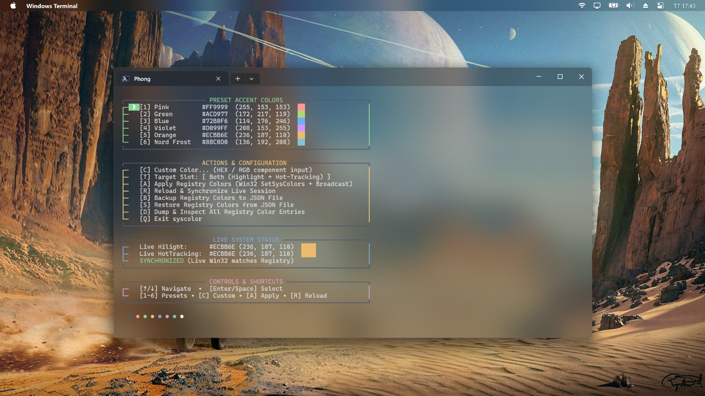

# syscolor

> Native Windows utility in Rust for refreshing and managing system accent colors after sleep and resume.

[](https://github.com/NV-Phong/syscolor/releases/latest)
[](LICENSE)

## Installation

Download `syscolor-0.1.2-x86_64.msi` from the [latest release](https://github.com/NV-Phong/syscolor/releases/latest) and run the installer.

The installer places `syscolor.exe` in `Program Files\syscolor\bin\` and optionally adds it to the system `PATH`.

## Usage

```powershell
# Launch interactive TUI select menu (default action)
syscolor

# Or explicitly
syscolor menu
syscolor -i

# Re-apply registry accent colors to the live session
syscolor apply

# Get the current live color value
syscolor get highlight
syscolor get hot-tracking

# Set a color by preset name or RGB components
syscolor set blue
syscolor set highlight violet
syscolor set hot-tracking 114 176 246

# Dump colors currently stored in the registry
syscolor dump

# Backup / restore registry colors
syscolor backup colors.json
syscolor restore colors.json
```

### Preset Colors

| Name     | RGB             |
|----------|-----------------|
| pink     | 255, 153, 153   |
| green    | 172, 217, 119   |
| blue     | 114, 176, 246   |
| violet   | 208, 153, 255   |
| orange   | 236, 187, 110   |

## Why this exists

Windows sometimes loses accent color state (Hilight, HotTrackingColor) after the system wakes from sleep. This tool reads the correct values from `HKCU\Control Panel\Colors`, calls `SetSysColors`, and broadcasts `WM_SYSCOLORCHANGE` + `WM_SETTINGCHANGE` so all running applications update immediately — no reboot needed.

## Build from source

**Requirements:** Rust stable toolchain (`x86_64-pc-windows-msvc`), [WiX Toolset v3.14](https://github.com/wixtoolset/wix3/releases/tag/wix3141rtm), `cargo-wix`.

```powershell
cargo install cargo-wix
.\build-release.ps1
# MSI output: target\wix\syscolor-<version>-x86_64.msi
```

## Module Layout

| File | Responsibility |
|------|---------------|
| `src/main.rs` | Entry point, tracing init |
| `src/cli/commands.rs` | CLI parsing and command dispatch |
| `src/cli/menu.rs` | Interactive Fastfetch-style TUI select menu |
| `src/color.rs` | RGB ↔ COLORREF conversion |
| `src/constants.rs` | `SystemColorSlot` definitions |
| `src/registry.rs` | Registry read/write |
| `src/win32.rs` | Unsafe Win32 wrapper layer |
| `src/system_colors.rs` | Business logic |
| `src/broadcast.rs` | WM_SYSCOLORCHANGE / WM_SETTINGCHANGE broadcast |

> Unsafe code is isolated entirely in `src/win32.rs`.

## Interactive TUI updates

- Right-border accent: the menu right border (`│`) now uses the section accent color so each section's border matches its accent.
- Arrow selection highlight: only the selection arrow (`❯`) uses an accent background with a centered arrow block; the rest of the row remains transparent to preserve terminal background.
- Selected-row spacing: an extra space is added before the right border on the selected row to keep the border visually aligned.
- Controls & Shortcuts: duplicate/alternate key hints were simplified to reduce clutter.
- Tests & build: local `cargo build` and `cargo test` completed successfully (unit tests passed).

To visually verify the changes run:

```powershell
cargo run --manifest-path Cargo.toml
```


## Screenshot

Below is a screenshot of the interactive TUI menu (rendered in Windows Terminal):



## License

[MIT](LICENSE) © 2026 NV-Phong